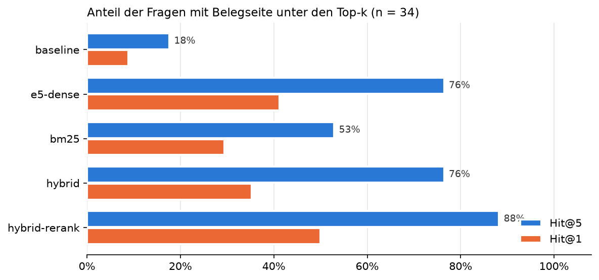
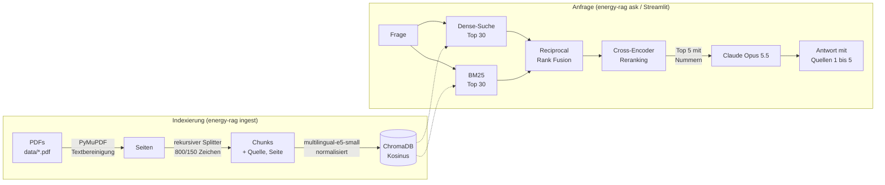

# ⚡ Energy-RAG – Fragen an Studien zum deutschen Strommarkt

[](https://github.com/kreik-ship-it/rag_pipeline/actions/workflows/ci.yml)


Retrieval-Augmented-Generation-System für drei umfangreiche deutschsprachige Fachstudien
(**~650 Seiten**): Monitoringbericht 2024 von Bundesnetzagentur und Bundeskartellamt,
Fraunhofer-ISE-Studie zu Stromgestehungskosten 2024 und die UBA-Studie zur Transformation
der Stromerzeugung bis 2050.

Das Projekt deckt die ganze Kette ab – **Ingestion → Chunking → Embeddings → Vektorspeicher →
Hybrid-Retrieval mit Reranking → Antwortgenerierung mit Quellenangaben** – und misst jede
Designentscheidung auf einem **handannotierten Testset** statt sie nur zu behaupten.

---

## Kernergebnisse

Retrieval-Qualität auf 34 Fragen mit bekannter Belegseite (ein Treffer zählt, wenn ein
abgerufener Chunk von einer Seite stammt, auf der die Antwort steht):

| Konfiguration | Hit@1 | Hit@3 | Hit@5 | Hit@10 | MRR@10 | Latenz |
|---|---:|---:|---:|---:|---:|---:|
| Ausgangsstand: MiniLM (englisch), 1000/200 Zeichen, dense | 0,09 | 0,18 | 0,18 | 0,29 | 0,14 | 22 ms |
| Multilinguales E5, 800/150, dense | 0,41 | 0,65 | 0,76 | 0,82 | 0,56 | 36 ms |
| BM25 (lexikalisch) | 0,29 | 0,47 | 0,53 | 0,76 | 0,42 | 4 ms |
| Hybrid E5 + BM25 (Reciprocal Rank Fusion) | 0,35 | 0,62 | 0,76 | 0,88 | 0,53 | 40 ms |
| **Hybrid + Cross-Encoder-Reranking** | **0,50** | **0,79** | **0,88** | **0,97** | **0,65** | 5,3 s* |

<sub>* CPU-Laptop, 30 Kandidaten je Anfrage; mit GPU bzw. weniger Kandidaten deutlich schneller.</sub>

1. **Das richtige Embedding-Modell ist der größte Hebel.** Der Ausgangsstand fand nicht
   einmal für jede fünfte Frage die Belegseite unter den Top 5 (18 %). Mit einem
   mehrsprachigen Modell (E5) sind es 76 % – mehr als das Vierfache.
2. **Zwei stille Fehler im Ausgangsstand:** 63 % der Chunks waren länger als das
   256-Token-Fenster des englischen Modells und wurden **abgeschnitten**, und die von
   Chroma gelieferte **L2-Distanz wurde als Kosinus-Distanz interpretiert** – Treffer mit
   Ähnlichkeit < 0,5 erhielten negative Scores und wurden weggefiltert (siehe Notebook).
3. **Reranking bringt den zweiten Sprung:** Mit Hybrid-Suche + Cross-Encoder steht die
   Belegseite bei **88 %** der Fragen in den Top 5 und bei **97 %** in den Top 10; MRR steigt
   von 0,56 (dense) auf 0,65. Hybrid-Suche *allein* verbessert nur den Recall der Kandidaten
   (Hit@10 0,82 → 0,88), nicht die Spitze der Rangliste – genau diese Kandidaten nutzt der
   Reranker. BM25 allein ist deutlich schwächer als die dichte Suche.
4. **Grenzen ehrlich benannt:** Eine Frage (Batteriespeicher-Kosten der ISE-Studie) findet
   die beste Konfiguration nicht in den Top 10 – die Antwort steht in einem dichten
   Zusammenfassungsabsatz zwischen vielen ähnlichen Zahlen. Beim UBA-Bericht schneidet die
   Hybrid-Suche ohne Reranker sogar besser ab (Details in der
   [Fehleranalyse](notebooks/01_rag_evaluation.ipynb)).



---

## Architektur



| Modul | Aufgabe |
|---|---|
| [`ingestion.py`](src/energy_rag/ingestion.py) | PDFs seitenweise laden (1-basierte Seitenzahlen), Silbentrennung zusammenführen, Bindestrich-Komposita erhalten, wiederkehrende Kopf-/Fußzeilen und Inhaltsverzeichnis-Punktleisten entfernen; defekte PDFs werden protokolliert statt den Lauf abzubrechen |
| [`chunking.py`](src/energy_rag/chunking.py) | Rekursives Splitten Absatz → Satz → Wort je Seite, deterministische Chunk-IDs (erneutes Indexieren erzeugt keine Duplikate) |
| [`embeddings.py`](src/energy_rag/embeddings.py) | Sentence-Transformers-Wrapper mit automatischen E5-Präfixen (`query:` / `passage:`) und normierten Vektoren |
| [`vector_store.py`](src/energy_rag/vector_store.py) | ChromaDB-Collection mit Kosinus-Distanz, Upsert in Batches, eigene Collection je Modell/Chunking |
| [`retrieval.py`](src/energy_rag/retrieval.py) | Dense, BM25 (deutsche Tokenisierung, Dezimalzahlen als ein Token), RRF-Fusion, Cross-Encoder-Reranking |
| [`generation.py`](src/energy_rag/generation.py) | Prompt mit nummerierten Quellen, Zitat-Extraktion und -Validierung, Claude-Client, Offline-Fallback |
| [`evaluation.py`](src/energy_rag/evaluation.py) | Hit@k, MRR, reproduzierbare Annotation der Belegseiten, Antwort-Evaluation mit LLM-as-a-Judge |
| [`cli.py`](src/energy_rag/cli.py) · [`app/`](app/streamlit_app.py) | Kommandozeile und Streamlit-Oberfläche |

---

## Schnellstart

```bash
git clone https://github.com/kreik-ship-it/rag_pipeline.git
cd rag_pipeline
python -m venv .venv && source .venv/bin/activate   # Windows: .venv\Scripts\activate
pip install -e ".[ui,dev]"                          # alternativ: uv sync --all-extras
```

1. Die drei PDFs herunterladen und in `data/` ablegen (Quellen: [`data/README.md`](data/README.md)).
2. Optional `cp .env.example .env` und `ANTHROPIC_API_KEY` eintragen. Ohne Key zeigt das
   System die relevantesten Fundstellen mit Quelle an (extraktiver Modus).

```bash
energy-rag ingest                     # Index aufbauen (~3 Min. auf CPU)
energy-rag ask "Wie stark sind die Netzentgelte für Haushalte 2024 gestiegen?"
energy-rag search "Kapazitätsmarkt Kosten" -k 5   # nur Retrieval
energy-rag evaluate                   # Retrieval-Vergleich → docs/results/
energy-rag evaluate --answers         # zusätzlich Antwortqualität (API-Key nötig)
streamlit run app/streamlit_app.py    # Weboberfläche
pytest                                # 40 Tests, offline
```

Beispiel: abgerufene Quellen für „Wie stark sind die Netzentgelte für Haushalte 2024
gestiegen?“ (Hybrid + Reranking, gekürzt). Der Strom-Abschnitt steht vor dem ähnlich
formulierten Gas-Abschnitt:

```text
[1] MonitoringberichtEnergie2024.pdf, S. 24  (Score 10.404)
    8. Netzentgelte Strom Die mengengewichteten Netzentgelte (inkl. Messstellenbetrieb) für
    das Jahr 2024 sind für Haushaltskunden um gut 24 Prozent deutlich angest …
[2] MonitoringberichtEnergie2024.pdf, S. 24  (Score 7.802)
    die Netzentgelte inklusive Messstellenbetrieb um rund 25 Prozent auf 4,12 ct/kWh …
[3] MonitoringberichtEnergie2024.pdf, S. 45  (Score 7.572)
    12. Netzentgelte Gas Das durchschnittliche mengengewichtete Netzentgelt …
```

Mit API-Key formuliert Claude daraus eine Antwort, die jede Aussage mit `[1]`, `[2]` … belegt.

---

## Methodische Entscheidungen

**Mehrsprachige Embeddings statt `all-MiniLM-L6-v2`.** Das ursprüngliche Modell ist auf
englischen Text trainiert. Deutsche Komposita („Stromgestehungskosten“) zerfallen in viele
Teilwörter, wodurch Chunks schnell das 256-Token-Limit überschreiten. `intfloat/multilingual-e5-small`
hat dieselbe Vektordimension (384), läuft weiterhin flott auf CPU, versteht Deutsch und erlaubt 512 Tokens.

**Chunking 800/150 Zeichen, seitenweise.** Ein Chunk (Ø 151 Tokens) passt vollständig ins
Modellfenster und enthält meist genau eine Aussage. Es wird pro Seite gesplittet, damit
jede Quellenangabe auf eine konkrete Seite zeigt.

**Hybrid-Suche mit Reciprocal Rank Fusion.** Fachfragen enthalten oft exakte Begriffe und
Zahlen (z. B. „SAIDI“, „CR5“), die lexikalische Suche zuverlässig findet. RRF kombiniert
die Rangfolgen, ohne die nicht vergleichbaren Scores von Kosinus und BM25 normieren zu müssen.

**Reranking mit Cross-Encoder.** Der mehrsprachige mMARCO-Cross-Encoder bewertet Frage
und Chunk gemeinsam. Er sortiert nur die 30 Kandidaten der Hybrid-Suche neu, so bleibt
der Aufwand begrenzt. Er ist abschaltbar (`RAG_USE_RERANKER=false`), wenn Latenz wichtiger ist.

**Generierung mit Quellenpflicht.** Die Top-5-Chunks gehen nummeriert, mit Dokument und
Seite an Claude Opus 5.5. Der System-Prompt verlangt Belege `[n]` für jede Aussage,
exakte Zahlen und ein ausdrückliches „steht nicht in den Quellen“, statt zu raten.
Die Antwort wird geparst: Zitate auf nicht existierende Quellen werden erkannt
(`Answer.invalid_citations`). Quellentexte sind als Daten markiert (Schutz vor
Prompt-Injection aus Dokumenten). Effort-Stufe, Modell und Fallback sind per `.env` konfigurierbar.

**Evaluation ohne Zirkelschluss.** Die 36 Testfragen (34 beantwortbar, 2 bewusst nicht
beantwortbar) sind in Alltagssprache formuliert und kopieren nicht den Wortlaut der Quelle.
Zu jeder Frage gibt es Evidenz-Muster (z. B. `4,3 und 9,2`), aus denen `energy-rag annotate`
**alle** Belegseiten automatisch bestimmt – auch Wiederholungen in Zusammenfassungen. So ist
das Testset nachvollziehbar und bei geändertem Parsing reproduzierbar.

**Sicherheit & Betrieb.** Keine Schlüssel im Code: `ANTHROPIC_API_KEY` kommt aus der
Umgebung bzw. `.env` (gitignoriert). Index-Aufbau ist idempotent (Upsert mit stabilen IDs),
jede Kombination aus Embedding-Modell und Chunking bekommt eine eigene Collection.

---

## Projektstruktur

```text
rag_pipeline/
├── src/energy_rag/          # Python-Paket (Pipeline-Module, CLI)
├── app/streamlit_app.py     # Weboberfläche
├── tests/                   # 40 pytest-Tests, ohne Netzwerk/Modelle/API-Key
├── notebooks/               # ausgeführtes Analyse- und Evaluations-Notebook
├── data/
│   ├── eval/testset.jsonl   # handannotiertes Testset (versioniert)
│   └── *.pdf, vector_store/ # Rohdaten und Index (gitignoriert)
├── docs/                    # Ergebnisse (JSON) und Abbildungen
├── scripts/build_notebook.py
├── .github/workflows/ci.yml # Ruff + pytest auf Python 3.11 und 3.13
├── .env.example
└── pyproject.toml
```

## Qualitätssicherung

- **40 Unit- und Integrationstests**: Textbereinigung inkl. Kopfzeilen-Erkennung, Chunk-Grenzen und IDs,
  Kosinus-Scores, Idempotenz des Upserts, BM25-Tokenisierung, RRF-Formel, Reranking,
  Prompt-Aufbau, Zitat-Parsing, Fallback- und Refusal-Behandlung, Metriken sowie ein
  End-to-End-Test mit generierten PDFs. LLM, Embedding- und Cross-Encoder-Modelle werden
  durch deterministische Fakes ersetzt.
- **Ruff** für Linting und Formatierung, **GitHub Actions** für beides plus Tests.

## Grenzen und Ausblick

- **Testset-Größe:** 34 Fragen reichen für klare Unterschiede (0,18 → 0,88 Hit@5), nicht
  aber für feine Vergleiche zwischen ähnlichen Konfigurationen.
- **Antwortqualität** wird mit `energy-rag evaluate --answers` per LLM-as-a-Judge gemessen
  (Korrektheit gegen Referenzantwort, Faithfulness gegenüber den Quellen, Zitierquote). Die
  Zahlen im Repository beschränken sich auf das Retrieval, da dafür kein API-Key nötig ist.
- **Tabellen und Abbildungen** werden nur als Fließtext extrahiert; viele Kennzahlen der
  Studien stehen in Grafiken. Nächster Schritt: Layout-bewusstes Parsing (z. B. Tabellen-
  Extraktion) oder multimodale Verarbeitung von Seitenbildern.
- **Weitere Ideen:** Query-Rewriting für sehr kurze Fragen, Metadaten-Filter (Dokument,
  Jahr), Streaming-Antworten in der Oberfläche, größeres E5-Modell auf GPU.
